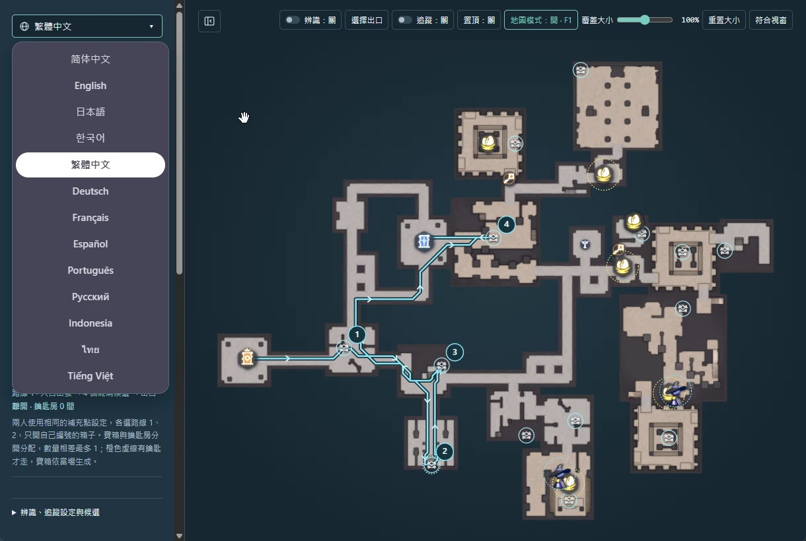
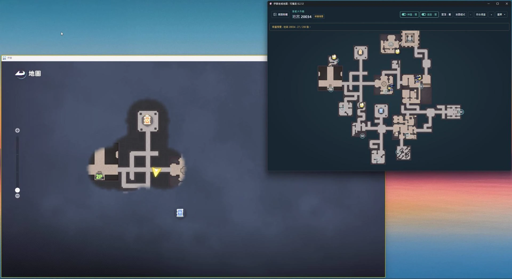
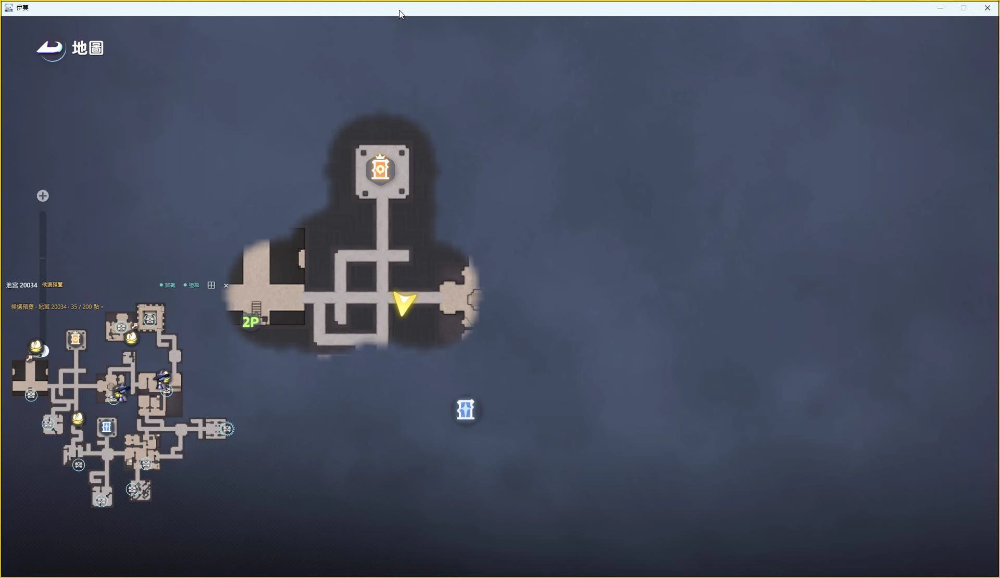
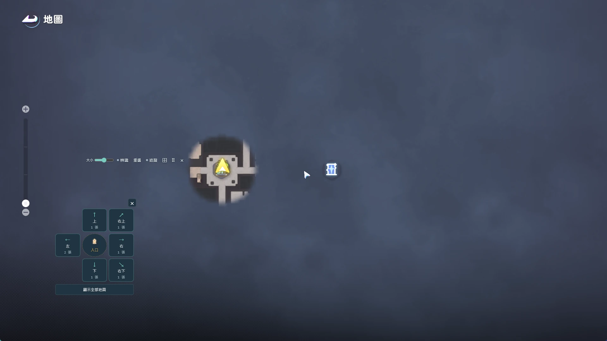

# Aniimo Dungeon Map

[繁體中文](README.md) | **English**

A Windows map companion for Aniimo's Egg Scramble mode. Covers 12 dungeons on Nightmare and Chaos, with chest, egg-nest, and boss markers, manual map selection, player tracking, and a transparent map overlay. Map data comes from game resource version 3846247.

**[Download Windows portable EXE](https://github.com/FCL2025/aniimo-dungeon-map/releases/latest/download/AniimoDungeonMap.exe)** · [Release notes and ZIP](https://github.com/FCL2025/aniimo-dungeon-map/releases/latest)

**[Download the Android test APK](https://github.com/FCL2025/aniimo-dungeon-map/releases/download/android-v0.1.2/AniimoDungeonMap-0.1.2-android-test.apk)** · [Android release](https://github.com/FCL2025/aniimo-dungeon-map/releases/tag/android-v0.1.2) · [Mobile guide (Traditional Chinese)](mobile/README.md)

The separate Android app supports Android 8.0 and later, with a draggable floating button and 12 offline maps. It provides manual map viewing without player tracking. Android uses its own version numbers and is currently a test release with a Traditional Chinese interface.

## Feature preview

**1. Support for 13 languages**

**2. Example: compare the full map with the game**

**3. Map overlay in the game**

**4. Choose an exit from the overlay**

Screenshots 2 and 3 show an older interface. Buttons and messages may differ in the latest version.

## Getting started

1. Run the portable `AniimoDungeonMap.exe` directly, or extract the ZIP first. Select **English** from the language menu at the top of the sidebar.
2. Press **M** in the game and find the exit relative to the entrance. Click **Choose exit** in the app. If multiple maps share a direction, compare their previews; use **Show all maps** if unsure.
3. Choose the difficulty and visible markers in the sidebar. Click **Overlay** to show the transparent map over the game.
4. For the next run, click **Reselect** on the overlay to choose another map without returning to the main window.

To track your position, select a map, turn on **Track**, then close the game's M-map and return to gameplay.

Set **Game resolution** in the sidebar to 1920×1080 for 16:9 (including 2560×1440), or 3440×1440 for 21:9. The setting is saved; changing it resets tracking. At 1440p, the overlay defaults to about 790×790.

## Common controls

| Control | Action |
| --- | --- |
| **F1** | Hide or show the overlay |
| Mouse wheel / drag the map | Zoom / pan |
| Drag the move handle at the top of the overlay | Reposition the overlay |
| **Overlay size** / **Reset size** | Resize the overlay / restore its default size |
| **× / Esc** in the exit picker | Cancel selection and restore the previous map |
| Language menu at the top of the sidebar | Change the language in both windows |

For two-player chest routes, enable **Show suggested route**, use the same **Show inferred room markers** setting, and choose separate routes, 1 and 2. Open only your numbered chests. Orange dashed paths require a key; gold chests are not assigned to either route.

## Before you play

- Supports Windows 10/11 x64; tracking requires Windows 10 version 1903 or later. Install [WebView2 Runtime](https://developer.microsoft.com/microsoft-edge/webview2/) if it is missing.
- Use windowed or borderless mode. Press **Alt** first if the game locks the cursor. You can minimize the main window while the overlay is open.
- The app checks GitHub Releases for newer versions and offers a portable EXE download. Close the old app before replacing it. Map, language, route, and other settings are retained for the same Windows account.
- Markers indicate possible spawns, not guaranteed ones. Opened chests are not recorded automatically. Fog can affect player tracking; player floor tracking is not supported. Higher chest markers carry a 2F badge.

For more controls, open **Help** at the bottom of the sidebar.

Open **Loot value ranking** above Help to compare 24 gold chest treasures, two high-grade energy stones, Gold Essence, the Gilded Key, Purple Essence, two basic energy stones, and three purple items worth strictly more than 7,000 per weight: the Silver-Plated Key and two medium-grade energy stones. Backpacks, attack amplifiers, chips, and defense chassis are excluded. Ranking assumes **25 slots, 70 kg, and one item per slot**: **bag CP = sale price ÷ max(1, weight ÷ 2.8)**, highest first with ties. Items up to 2.8 kg compete on price per slot; heavier items are discounted for weight.

The same sidebar section includes daily Chaos Ticket and Mystery Egg Box purchase guides. Assuming 300,000 Shell Coins from each successful Chaos run, buying and using 10 tickets yields the maximum daily cash net of 1,760,000. Tickets 11–15 leave it unchanged; ticket 16 onward lowers it. The first nine boxes cost 500,000 each, or 4,500,000 total. Their opening odds are unknown, so nine is a price-tier budget suggestion.

The table shows original game icons, weight, sale price, bag CP, and a same-item packing estimate with whole-item count, total weight, and total sale value. For example, a 1 kg basic energy stone worth 7,000 fits 25 times for 175,000, while a 3 kg Rainbow Diamond worth 34,560 fits 23 times for 794,880. These estimates assume enough copies. Drop rates are unknown, so totals are not expected earnings per run; mixed bags still require checking remaining slots and weight. Item names use the game's translations for the selected language, with English as a fallback when unavailable.
