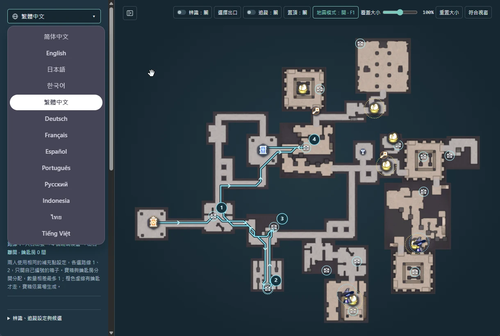
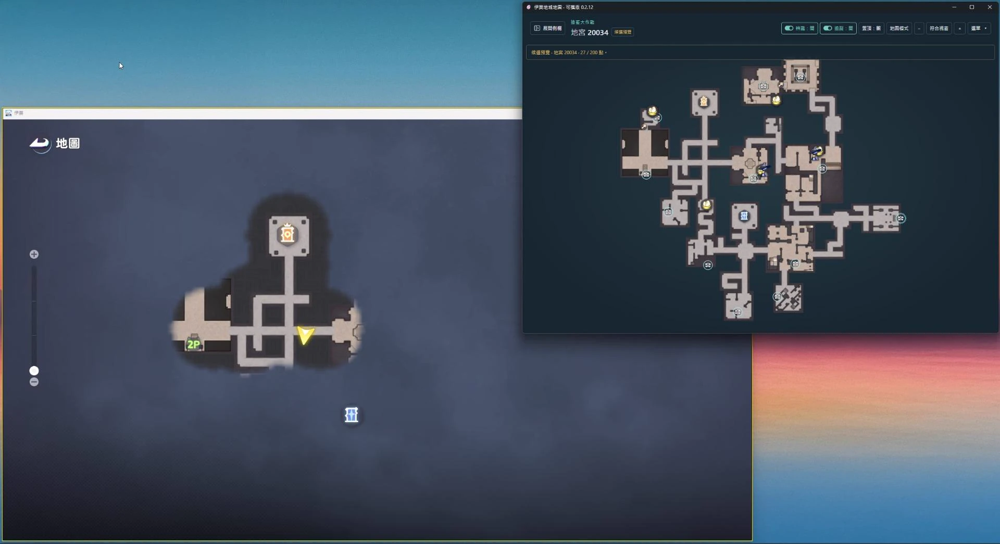
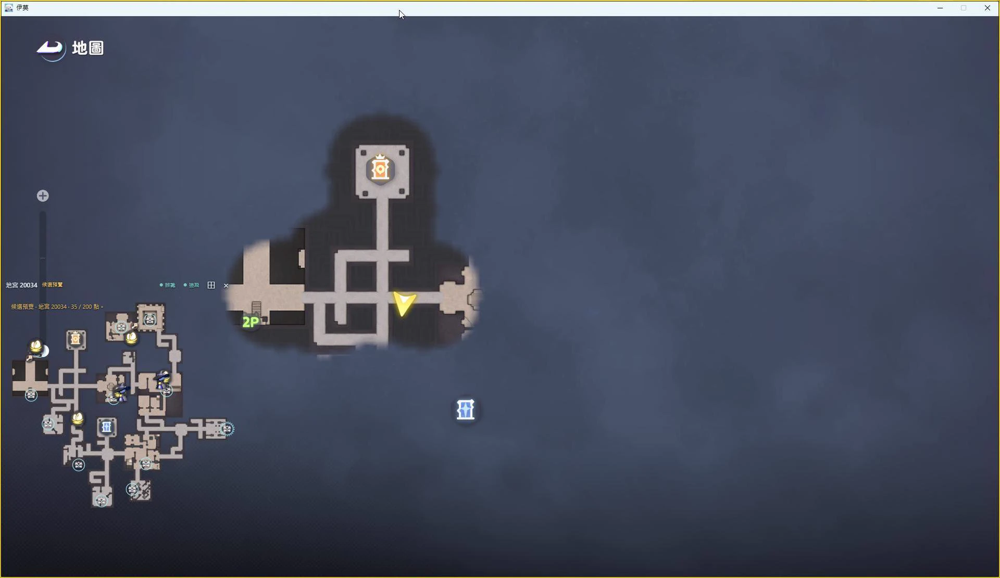
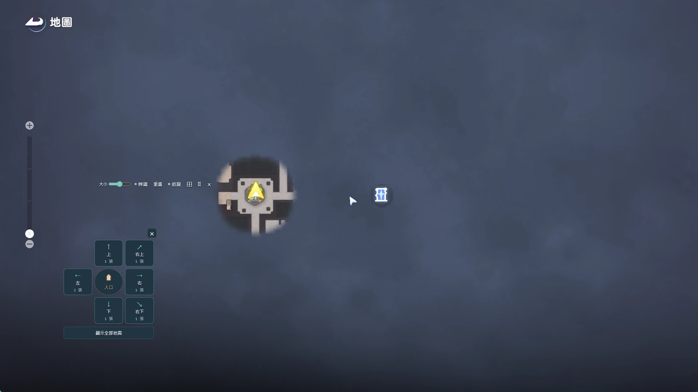

# 伊莫搶蛋地圖

**繁體中文** | [English](README.en.md)

伊莫搶蛋模式的 Windows 地圖工具。側欄可切換 PVE 與 PVP：PVE 支援惡夢與混沌的 12 張地宮，以及寶箱／蛋巢／頭目標記、自動辨識、手動選圖與人物追蹤；PVP 將「搶蛋大作戰」分為六張區域地圖，顯示脈源之繭、珍稀寶箱、精緻遺跡寶箱及三色小隊集結點。兩種模式都可使用透明覆蓋地圖。地圖資料使用遊戲資源版本 3846247。

**[下載 Windows 免安裝版 EXE](https://github.com/FCL2025/aniimo-dungeon-map/releases/latest/download/AniimoDungeonMap.exe)** · [版本更新與 ZIP 下載](https://github.com/FCL2025/aniimo-dungeon-map/releases/latest)

**[下載 Android 測試版 APK](https://github.com/FCL2025/aniimo-dungeon-map/releases/download/android-v0.1.2/AniimoDungeonMap-0.1.2-android-test.apk)** · [Android 發布頁](https://github.com/FCL2025/aniimo-dungeon-map/releases/tag/android-v0.1.2) · [安裝與操作說明](mobile/README.md)

Android 8.0 以上可用：拖曳浮動按鈕、點擊展開／收合 12 張離線地圖，僅供手動看圖、不追蹤人物。Android 版使用獨立版本編號，目前為測試版。

## 功能預覽

**1. 支援各國語言（13 種）**



**2. 範例圖 1：主視窗與遊戲地圖對照**



**3. 遊戲中的小地圖**



**4. 小地圖選擇出口**



圖 2、3 為舊版介面示意，實際按鈕與提示以最新版為準。

## 開始使用

1. 直接執行免安裝版 `AniimoDungeonMap.exe`；使用 ZIP 時請先完整解壓。
2. 開啟上方「辨識」，再在遊戲按 **M**。確認地圖後會自動切圖並停止辨識；下一場可關閉再開啟辨識。也可手動選圖：在遊戲按 **M**，以入口為中心確認出口方向，再按工具的「選擇出口」。九宮格也會列出接近邊界的相鄰候選；先對照入口對齊、比例一致的「門位」圖，必要時切換「地形」，再點選符合的地圖。即使只有一張也需點選確認；不確定可按「顯示全部地圖」。
3. 在側欄選擇難度與要顯示的標記，按「地圖模式」即可在遊戲上方顯示透明小地圖。
4. 進入下一場時，按小地圖上的「重選」重新選圖，不需回到主視窗。

PVE 側欄的「開始本局撤離提醒」會每 2 秒檢查遊戲左側撤離條件。連續兩次確認「搭乘蛋船安全撤離」後，播放一次提示音並自動停止；下一局再按一次啟動，判斷中也可按同一按鈕取消。目前支援繁體中文遊戲介面，音效已內嵌，不需另外放置 WAV。提醒可獨立使用，也可與地圖辨識及人物追蹤同時開啟。

側欄「辨識、追蹤設定與候選」可匯入 M 地圖截圖、選擇遊戲視窗及調整擷取範圍。辨識涵蓋全部 12 張 PVE 地宮。每張都有初始迷霧參考，取自遊戲資源合成的進場畫面；剛進場按 M 時，主要依正門／側門的距離與方向，加上起始房間地形確認。若地圖已拉近、看不到側門，或地形不足，可能需要多探索後再按 M。

需要人物位置時，選好地圖後開啟「追蹤」，再關閉遊戲的 M 地圖、回到遊玩畫面。

側欄「遊戲解析度」支援 16:9（1920×1080、2560×1440，選 1920×1080）與 21:9（3440×1440）。設定會保存，變更後會重設人物追蹤；覆蓋小地圖在 1440p 時預設約 790×790。

## 常用操作

| 操作 | 功能 |
| --- | --- |
| **F1** | 隱藏／恢復覆蓋小地圖 |
| 滑鼠滾輪／拖曳地圖 | 縮放／平移地圖 |
| 拖曳小地圖上方的移動圖示 | 調整覆蓋位置 |
| 「覆蓋大小」／「重置大小」 | 調整小地圖尺寸／恢復預設 |
| 出口選單 **×／Esc** | 取消選擇，恢復原本地圖 |
| 側欄最上方的語言選單 | 切換語言，同步到覆蓋小地圖 |

雙人分工時，勾選「顯示最佳路徑」，兩人使用相同的「顯示房間模組補充點」設定，各選路線 1、2，只開自己的編號寶箱。橙色虛線需有鑰匙才走，金色寶箱未納入分工。

## 使用須知

- 支援 Windows 10／11 x64；人物追蹤需要 Windows 10 1903 以上。若缺少 [WebView2 Runtime](https://developer.microsoft.com/microsoft-edge/webview2/)，請先安裝。
- 遊戲建議使用視窗或無邊框模式；滑鼠被鎖住時先按 **Alt**。覆蓋地圖開啟後，主視窗可最小化。
- 程式會檢查 GitHub Releases；有新版時可下載新的免安裝版 EXE，替換檔案前請先關閉舊版。同一個 Windows 帳號會保留選圖、語言、路線與其他設定。
- 標記是候選位置，不保證每場生成，也不會自動記錄已開寶箱。寶箱使用原始圖示，以金色／淺藍色外框區分類型；較高的寶箱候選點加註 **2F**。人物追蹤可能受迷霧影響，目前不判斷人物所在樓層。

更多操作可查看側欄底部的「說明」。

## Windows 下載或防毒警告

若看到「Windows 已保護您的電腦／不明的發行者」，這可能是 **SmartScreen 下載信譽警告**；未簽章或剛發布的檔案容易出現，並不等同已偵測到病毒。本機編譯的檔案通常沒有瀏覽器加入的網際網路來源標記，所以作者本機沒有警告，不能代表下載者也不會遇到。[Microsoft 說明](https://learn.microsoft.com/en-us/windows/apps/package-and-deploy/smartscreen-reputation)

請只從本專案 GitHub Releases 下載，並用 PowerShell 核對同一版本 `SHA256SUMS.txt` 中的 EXE 雜湊：

```powershell
Get-FileHash .\AniimoDungeonMap.exe -Algorithm SHA256
```

若 Windows 安全性顯示 **Trojan、PUA 等威脅名稱**或隔離／刪除檔案，請停止使用並回報：警告完整文字、程式版本、下載網址、檔案 SHA-256，以及 Defender 安全性情報版本。這類偵測需個別查核，必要時由開發者向 [Microsoft 提交檔案分析](https://www.microsoft.com/en-us/wdsi/filesubmission)。請勿關閉防毒或加入排除清單；雜湊一致只確認檔案相同，本機掃描通過也不保證所有裝置都不會警告。

## 道具與購買建議

側欄「說明」上方的「道具價值排名」收錄 24 種金色寶箱寶物、高級及初級脈衝與諧振能量石、金魄、鎏金鑰匙、紫魄，以及每單位重量價值嚴格大於 7,000 的 3 種紫色道具（鍍銀鑰匙與兩種中級能量石）。背包、攻擊增幅器、晶片和防護機體不列入。排名以 **25 格、70 kg、每件佔 1 格**計算：每格平均可分配 2.8 kg，**背包 CP＝售價 ÷ max(1, 重量 ÷ 2.8)**，由高到低、同值並列。2.8 kg 以下以每格售價比較，較重道具再按重量折算。

同區另有混沌船票每日購買與謎之蛋盒購買建議。若每場混沌成功獲得 300,000 蛋殼幣，買 10 張船票並完成 10 場時，每日現金淨額為 1,760,000；第 11～15 張只持平，從第 16 張起下降。時間較少時可參考 6 張的選項。蛋盒前 9 個每個 500,000、合計 4,500,000；因未取得開盒機率，9 個僅是價格級距預算建議。

表格顯示遊戲原始圖示、重量、售價、背包 CP，以及同種道具的裝包試算（最多件數、總重量、總售價）。例如 1 kg／7,000 的初級能量石最多帶 25 顆，共 175,000；3 kg／34,560 的虹彩寶鑽最多帶 23 顆，共 794,880。試算假設有足夠同種道具；掉落機率未知，不代表每場收益。CP 是一般拾取參考，混裝時仍需依剩餘格數與重量調整。道具名稱隨語言切換，缺少遊戲翻譯時顯示英文。
